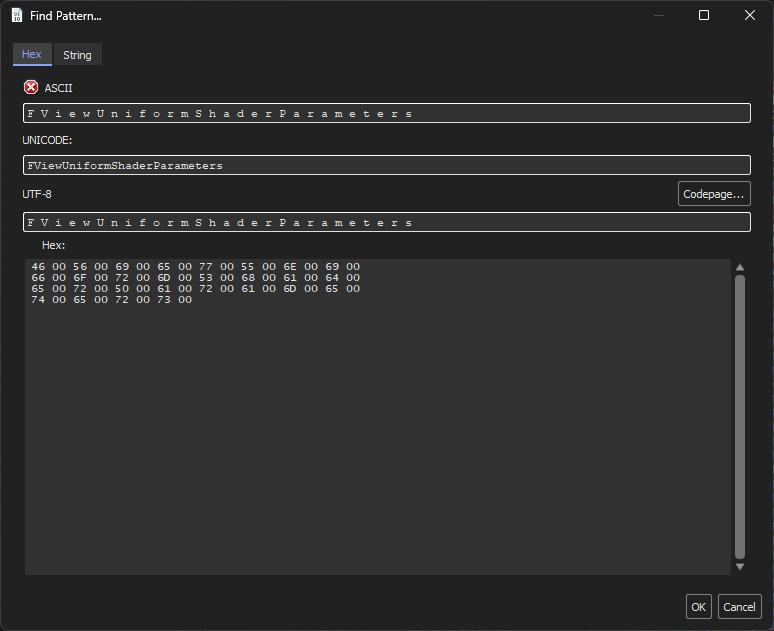
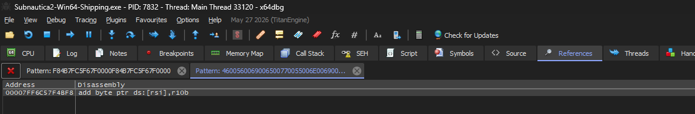
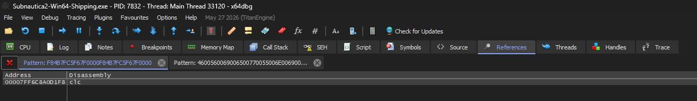
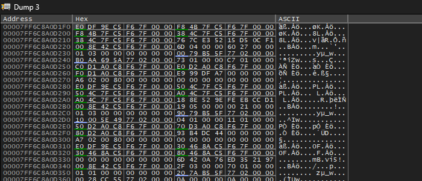
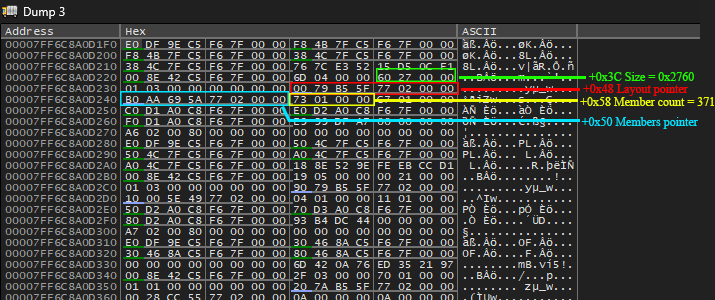
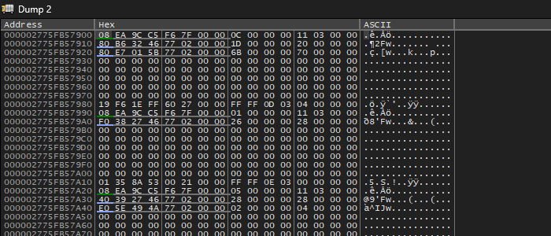
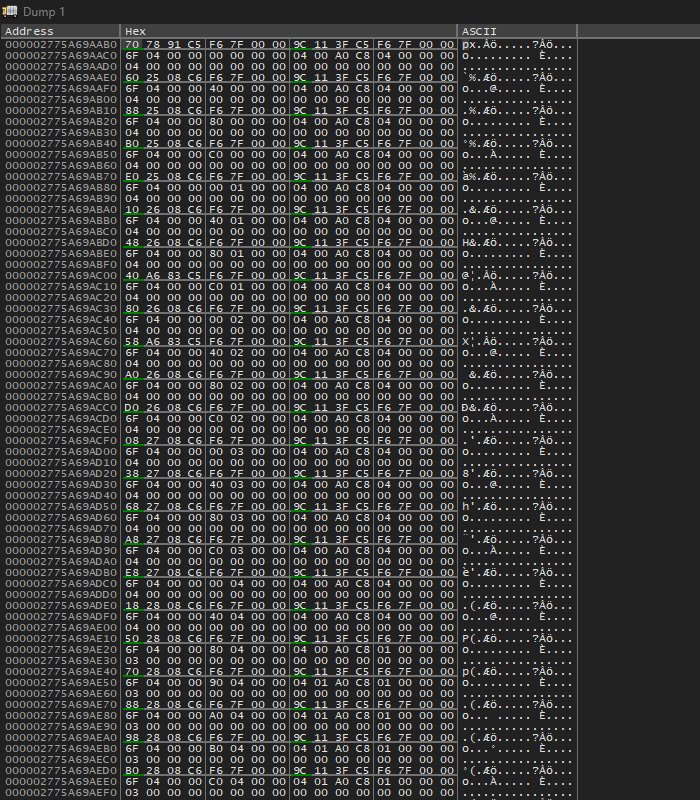

# Manually Recovering Subnautica 2 Shader Layouts

This documents the manual process used to identify and reproduce the Subnautica 2 shader parameter layout changes before oatmealf was written. oatmealf automates most of this process.

## 1. Cooked shaders not rendering properly, logs say nothing

Default verbosity doesn't show anything. Setting more verbose logging with `-LogCmds="LogMemoryImage Verbose, LogShaders Verbose"` shows:

```text
Mismatch hash for type FMaterialShaderMapContent
```

This means the cooked material shader map fails a layout checksum while loading and the material falls back. Since we are using the same UE version as the game, this was the first clue that UW changed the engine structs from stock.

## 2. Allow the FMaterialShaderMapContent hash mismatch

Source file changed: `Engine/Source/Runtime/Core/Private/Serialization/MemoryImage.cpp`

In `FPointerTableBase::LoadFromArchive`, stock UE sets `bValid = false` when the saved and local layout hashes differ. This was patched to accept the mismatch only when:

- the data being read is cooked (no editor layout parameters)
- the reader is `FMaterialResourceProxyReader` (the material inline shader map path)
- the mismatched type is `FMaterialShaderMapContent`

```cpp
const bool bAllowCookedMaterialShaderMapContentHashMismatch =
    !LayoutParams.WithEditorOnly() &&
    Ar.GetArchiveName() == TEXT("FMaterialResourceProxyReader") &&
    Name == FName(TEXT("FMaterialShaderMapContent"));

if (!bAllowCookedMaterialShaderMapContentHashMismatch)
{
    UE_LOG(LogMemoryImage, Verbose, TEXT("Mismatch hash for type %s"), *Name.ToString());
    bValid = false;
}
```

## 3. Find which uniform buffers don't match

Now the games shaders actually tried to load and draw, but the materials were still rendering wrong because some uniform buffers could not bind.

Each cooked shader carries useful metadata like a resource table of layout hashes for the buffers it binds, and a table of the buffers names. Since stock UE looks these up by hash and doesn't report the matching name when the lookup fails, logging was added that prints the name, cooked hash and editor hash of every buffer that fails to resolve.

The cooked hash is also registered as an alias for the same named editor buffer so shader setup can continue to the point where the shader tries to bind it.

Source file changed for pairing the names with the hashes: `Engine/Source/Runtime/RHICore/Public/RHICoreShader.h`

```cpp
const TArray<uint32>& LayoutHashes =
    Shader->GetShaderResourceTable().ResourceTableLayoutHashes;
const TArray<FName>& Names = Shader->Debug.UniformBufferNames;

for (int32 Index = 0; Index < LayoutHashes.Num(); ++Index)
{
    const uint32 Hash = LayoutHashes[Index];
    if (Hash == 0 || FindUniformBufferStructByLayoutHash(Hash))
    {
        continue;
    }

    const int32 NameIndex = Index + NameOffset;
    if (!Names.IsValidIndex(NameIndex) || Names[NameIndex] == RootConstantsName)
    {
        continue;
    }

    RegisterCookedUniformBufferLayoutHashAlias(Hash, Names[NameIndex]);
}
```

Source file changed for the alias registry and logging: `Engine/Source/Runtime/RenderCore/Private/ShaderParameterMetadata.cpp`

```cpp
UE_LOG(LogShaders, Display,
    TEXT("Cooked shader preview: aliased cooked uniform buffer layout hash 0x%08x -> '%s' (editor hash 0x%08x)."),
    CookedHash, Metadata->GetShaderVariableName(), Metadata->GetLayout().GetHash());
```

Source file changed for bind time debugging: `Engine/Source/Runtime/RHI/Internal/RHIUniformBufferUtilities.h`

```cpp
UE_LOG(LogRHI, Warning,
    TEXT("Cooked shader preview: skipped uniform-buffer resource table for shader '%s' slot %d UB='%s' reason=%s boundHash=0x%08x expectedHash=0x%08x."),
    Shader.GetShaderName(),
    BufferIndex,
    *Shader.GetUniformBufferName(BufferIndex),
    Reason,
    BoundHash,
    ExpectedHash);
```

After setting up the logging, this exposed five mismatched buffers:

```text
Cooked shader preview: aliased cooked uniform buffer layout hash 0xff1ef619 -> 'View' (editor hash 0xf11eca3c).
Cooked shader preview: aliased cooked uniform buffer layout hash 0x496b0d14 -> 'ShadowDepthPass' (editor hash 0x4c6f0d14).
Cooked shader preview: aliased cooked uniform buffer layout hash 0x3f70bb49 -> 'DistortionPass' (editor hash 0x3a79be18).
Cooked shader preview: aliased cooked uniform buffer layout hash 0x74e58e3a -> 'TranslucentBasePass' (editor hash 0x78fb9ff8).
Cooked shader preview: aliased cooked uniform buffer layout hash 0x034dd940 -> 'OpaqueBasePass' (editor hash 0x0b48d145).
```

## 4. Read the games layout from memory

Now we know the names of the uniform buffers that don't match, their expected hashes and the editor hashes. The engine keeps runtime metadata for every registered uniform buffer, including its name, size, layout hash, resources and reflected members. These can be read from the running game and then compared with the editor.

I used `View` as the starting point. In UE source its metadata type is `FViewUniformShaderParameters`, defined in `Engine/Source/Runtime/Engine/Public/SceneView.h`.

Using x64dbg for this example. Search for the string reference:

```text
FViewUniformShaderParameters
```



This found the string at `0x07FF6C57F4BF8`.



Next we find the metadata object which points to that string.

```text
F84B7FC5F67F0000
```

`FViewUniformShaderParameters` stores the same type name pointer in the `LayoutName` and `StructTypeName` fields. Searching for two copies together filters out unrelated single references.

```text
F84B7FC5F67F0000F84B7FC5F67F0000
```

This found the pair at `0x07FF6C8A0D1F8`.



The match starts at the metadata objects `+0x08` field, so subtract 8. The metadata object for this begins at `0x07FF6C8A0D1F0`.

Open a Dump pane and enter the metadata address from earlier:

```text
0x07FF6C8A0D1F0
```



The fields needed from the game are:

```text
+0x3C  Struct size
+0x48  FRHIUniformBufferLayout pointer
+0x50  Members array pointer
+0x58  Members count
```

In this dump they are:

```text
+0x3C  size            0x2760
+0x48  layout pointer  0x02775FB57900
+0x50  members pointer 0x02775A69AAB0
+0x58  member count    371
```



These offsets come from the compiled field order of `FShaderParametersMetadata` in `Engine/Source/Runtime/RenderCore/Public/ShaderParameterMetadata.h`.

```text
+0x00  vtable pointer             8 bytes
+0x08  LayoutName pointer         8 bytes
+0x10  StructTypeName pointer     8 bytes
+0x18  ShaderVariableName pointer 8 bytes
+0x20  StaticSlotName pointer     8 bytes
+0x28  FHashedName                8 bytes
+0x30  FileName pointer           8 bytes
+0x38  FileLine                   4 bytes
+0x3C  Size                       4 bytes
+0x40  UseCase                    1 byte
+0x41  BindingFlags               1 byte
+0x42  UsageFlags                 1 byte
+0x43  alignment padding          5 bytes
+0x48  Layout pointer             8 bytes
+0x50  Members.Data pointer       8 bytes
+0x58  Members.Num                4 bytes
+0x5C  Members.Max                4 bytes
```

The editor version has an extra editor only pointer before these fields, so use `+0x44` for size, `+0x50` for the layout pointer, `+0x58` for the members pointer and `+0x60` for the member count when doing the same dump for the editor.

Next open `FRHIUniformBufferLayout`:

```text
[0x7FF6C8A0D1F0+48]
```



The layout hash is at `+0x80` and the constant-buffer size follows it at `+0x84`:

```text
19 F6 1E FF 60 27 00 00
 0xff1ef619    0x2760
```

This confirms that the live game metadata contains the same `View` hash reported by the cooked shader. These offsets were checked against `FRHIUniformBufferLayout` in `Engine/Source/Runtime/RHI/Public/RHIResources.h`.

Next open the member list:

```text
[0x7FF6C8A0D1F0+50]
```



Each `FShaderParametersMetadata::FMember` record is `0x30` bytes:

```text
+0x00  Name pointer
+0x08  Shader type pointer
+0x10  Source line
+0x14  Member offset
+0x18  Base type
+0x19  Precision
+0x1C  Rows
+0x20  Columns
+0x24  Array element count
+0x28  Nested struct metadata pointer
```

Follow the pointer at `+0x00` to read each member name, then move forward `0x30` bytes for the next record. Record the name, offset, type, dimensions, array count and nested struct pointer.

Repeat this in the editor, then compare the game and editor records in order. If a member is a nested struct, follow its `+0x28` pointer and compare that struct the same way.

The same process can be repeated for the other four type names found in UE source:

```text
View                FViewUniformShaderParameters
OpaqueBasePass      FOpaqueBasePassUniformParameters
TranslucentBasePass FTranslucentBasePassUniformParameters
ShadowDepthPass     FShadowDepthPassUniformParameters
DistortionPass      FDistortionPassUniformParameters
```

Their source files are:

```text
Engine/Source/Runtime/Engine/Public/SceneView.h
Engine/Source/Runtime/Renderer/Private/BasePassRendering.h
Engine/Source/Runtime/Renderer/Private/ShadowRendering.h
Engine/Source/Runtime/Renderer/Private/DistortionRendering.cpp
```

Comparing the game and editor layouts showed where resources or constants had been inserted. One of the main difference was a stencil SRV inserted into the shared scene textures struct:

Source file changed: `Engine/Source/Runtime/Engine/Public/SceneTexturesConfig.h`

```cpp
SHADER_PARAMETER_RDG_TEXTURE(Texture2D, SceneColorTexture)
SHADER_PARAMETER_RDG_TEXTURE(Texture2D, SceneDepthTexture)
SHADER_PARAMETER_RDG_TEXTURE_SRV(Texture2D<uint2>, SceneStencilTexture)
SHADER_PARAMETER_RDG_TEXTURE(Texture2D, ScenePartialDepthTexture)
```

That one shifts every later resource and was the cause of several buffer differences because those buffers nest the same scene textures struct.

The other layout changes were mirrored in these source files:

```text
Engine/Source/Runtime/Engine/Public/SceneView.h
Engine/Source/Runtime/Engine/Private/SceneManagement.cpp
Engine/Source/Runtime/Engine/Public/SceneTexturesConfig.h
Engine/Source/Runtime/Renderer/Private/SceneTextures.cpp
Engine/Source/Runtime/Renderer/Private/FogRendering.h
Engine/Source/Runtime/Renderer/Private/FogRendering.cpp
Engine/Source/Runtime/Renderer/Private/BlueNoise.h
Engine/Source/Runtime/Renderer/Private/BlueNoise.cpp
```

The changes reproduce the games member sizes, positions and resource slots. Placeholder names like `SN2ViewPad*` are used where the original UW field name is not available, because the compiled shader only cares about the fields type and byte position.

## 5. Check edits without rebuilding every time

The hash function is `FRHIUniformBufferLayoutInitializer::ComputeHash()` in:

```text
Engine/Source/Runtime/RHI/Public/RHIUniformBufferLayoutInitializer.h
```

The hash is made from the total constant buffer size, binding flags, whether it has a static slot, selected layout flags, each resources offset and type, and the CRC32 of the layout name.

The important part looks like this:

```cpp
TmpHash |= (ConstantBufferSize << 16);
TmpHash |= (static_cast<uint32>(BindingFlags) << 8);
TmpHash |= (StaticSlot != MAX_UNIFORM_BUFFER_STATIC_SLOTS ? 1 << 0 : 0);

for (int32 ResourceIndex = 0; ResourceIndex < Resources.Num(); ResourceIndex++)
{
    TmpHash ^= Resources[ResourceIndex].MemberOffset;
}

// Resource MemberType values are also packed into TmpHash here.
TmpHash ^= FCrc::StrCrc32(*Name);
Hash = TmpHash;
```

The exact stock function was copied into a small script. Struct edits could then be made and checked against the games hash without rebuilding the engine after every guess.

Once all five hashes matched the hashes from the game, and the engine was rebuilt, the five alias log messages stopped appearing because the cooked hashes now match editor layouts, and the materials rendered properly.

So the full process was:

```text
- allow cooked shader mismatch
- pair failed uniform buffer hashes with names
- read the game and editor layouts from memory
- compare their members and resource slots
- mirror the differences in engine source
- test ComputeHash without having to rebuild everytime
- rebuild after the hashes match
```
